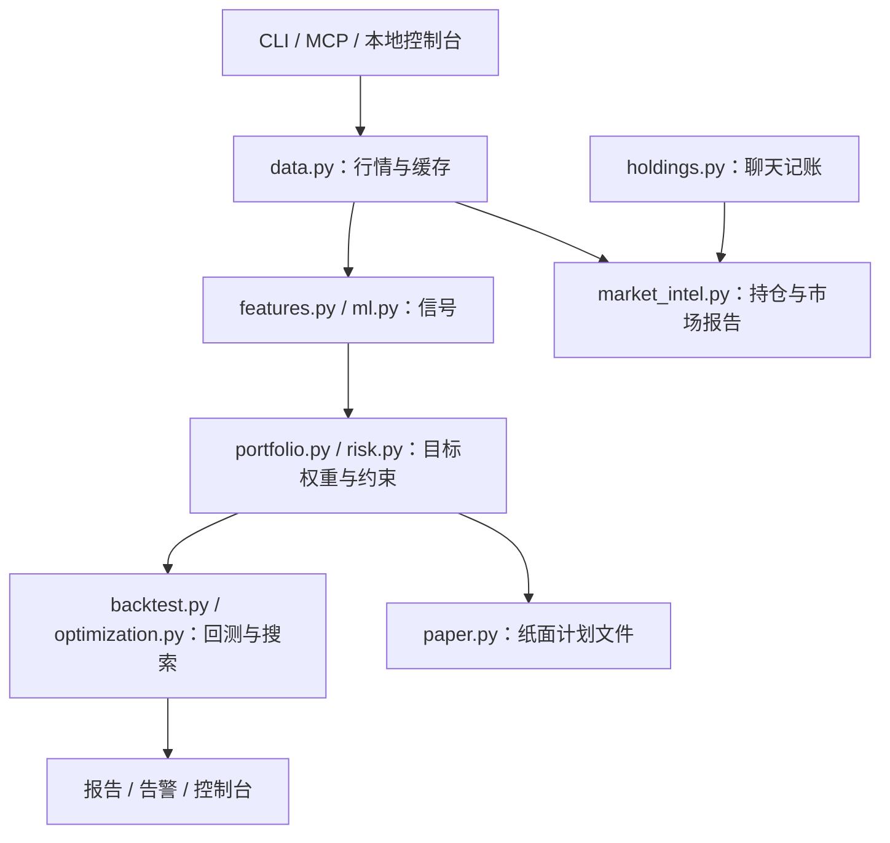
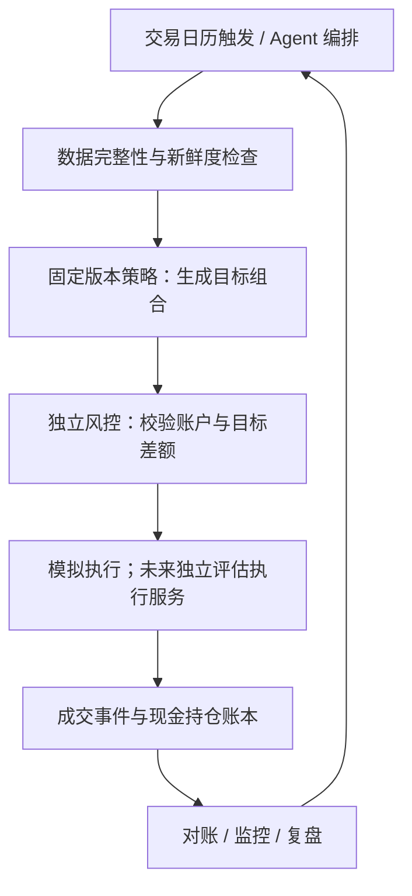

# quant.ai 项目分析与自动交易演进评估

分析日期：2026-10-18。依据本地源码、配置与已有报告；未重新下载行情或运行新的市场回测。当前项目仍遵守 AGENTS.md 的 Research only 边界，本文的未来架构不代表已实现或交易授权。

## 结论

项目适合继续作为自动化系统的研究内核，但目前没有自动交易闭环。已有数据、因子、目标权重、回测、报告和 MCP 接口；主要缺口是可靠的账户账本、成交模拟、订单状态管理、账户级风控和持续运行能力。增加一个下单接口不足以填平这些缺口。

策略是否有效、系统是否可靠、Agent 有多少自主权，是三个需要分别验证的问题。能自动运行不意味着能够盈利。

## 技术栈和目录

- Python 3.11+；pandas / NumPy 处理时间序列；scikit-learn 提供可选 Ridge 排名。
- yfinance 与本地 CSV / Parquet 数据；CSV 行情缓存、JSON 用户记账与报告文件。
- Typer CLI、FastMCP 接口、标准库 HTTP 本地控制台；pytest 离线测试、ruff 静态检查。
- `quant_agent/`：实现；`configs/`：策略及运行配置；`tests/`：离线测试；`reports/`：研究产物；`data/`：行情缓存及用户数据。

## 现有架构



文本细化版（同一结构）：

```text
CLI / MCP / 本地控制台 → data.py → features.py / ml.py
                                     ↓
                            portfolio.py / risk.py
                               ├→ backtest.py / optimization.py
                               │      └→ 报告 / 告警 / 控制台
                               └→ paper.py → 纸面计划文件
holdings.py → market_intel.py ← data.py
```

`pipeline.run_research_backtest` 串联研究任务；`server.Scheduler` 已有按间隔启动研究任务的能力，但不是交易所日历驱动的执行服务。`notifications.py` 提供文件和可选 webhook 通道。

`agents.ResearchReviewAgent` 是固定规则和模板，不调用模型；MCP 宿主负责对话解读。`holdings.py` 的用户持仓是记账上下文，不能代替成交驱动的真实或模拟账户账本。

## 当前策略与评估

`configs/my.yaml` 为月度调仓、最多五个仓位、四个基础因子等权：动量、均线趋势、反转、低波动。组合按排名选股，使用受单仓上限约束的等权权重。成本为佣金 10 bps 加滑点 5 bps 的简化模型。

本地 `reports/latest/summary.md` 记录当前策略测试段收益 -13.64%、Sharpe -0.3825、最大回撤约 -27.01%；验证集选择的权重在测试段收益 +7.35%、Sharpe 0.3158、最大回撤约 -27.74%。这些是已有文件记录，不是本次重新验证的结果，也不能推断未来收益；报告中的股票池与现配置亦不能假定完全一致。

优化器枚举因子的等权子集，以验证集指标选择组合。所谓 walk-forward 实现主要比较多个历史验证窗口的候选表现与稳定性；并非完整的逐窗口训练、冻结参数、下一段执行，再拼接纯样本外收益的交易流程。

## 源码中应优先处理的问题

1. **纸面计划遗漏清仓。** `paper.build_paper_order_plan` 从最新目标持仓向左合并当前持仓。已持有、但被新目标剔除的标的不会进入计划，因此无法生成其清仓记录。应使用目标与当前持仓的并集。
2. **流水线没有传入当前模拟持仓。** `pipeline.py` 调用计划构建器时省略 `current_positions`，默认空仓。CLI 可手动传 CSV，但没有成交后持续更新账本的闭环。
3. **可选 ML 标签错位。** `ml.py` 的收益计算先按 symbol 分组，但随后的 `shift(-horizon)` 作用于整个 Series；输入按日期和 symbol 排序时，移位会跨标的，不能当作该股票未来收益。应在每个标的内部生成标签。
4. **ML 时间隔离不足。** 训练样本按特征日期截取，没有剔除标签终点超出训练截止日的样本；训练后的模型又评分全部历史行。训练段结果不能当作样本外证据。未找到训练 period 时回退全表，也应改为明确报错。
5. **回测不是账户仿真。** 目标权重前向填充并整体滞后一日计算收益，成本按目标权重变化扣除；没有价格变化引起的权重漂移、现金与股数账本、真实成交时点或部分成交。滞后一日降低了直接同日信号偏差，但不能解释成已模拟下一开盘成交。
6. **信号口径需要核对。** `momentum_12_1` 使用 `pct_change(252).shift(21)`，对应整体向前移一个月的一年收益，与常见的“过去一年剔除最近一月”口径不同。应明确公式，避免名称误导。
7. **月末识别依赖样本终点。** `_rebalance_dates` 取每个样本月份的最后一行；运行于月中时，本月最后可用交易日也会被标为调仓日。自动运行需由交易日历与明确的调仓计划决定触发。
8. **风控范围有限。** 现有目标检查覆盖持仓数、单仓、只做多、换手；不能据此认定已检查现金、总敞口、未成交订单、数据新鲜度、累计亏损或账户一致性。数据质量报告中的 `point_in_time_ready` 仅依据列是否存在，不能证明历史时点数据合格。

以上为源码检查结论；本次未修改实现，也未为每项缺陷新增复现测试。

## 目标系统的职责分配

建议 Agent 负责读取证据、调用固定策略、说明变化、巡检和复盘；可执行目标由版本固定的策略产生，独立风控拥有最终否决权。策略版本变更与每日运行分开，避免每日临场改参数导致无法评价。

未来执行闭环（尚未实现）：



```text
交易日历触发 / Agent 编排
  → 数据完整性与新鲜度检查
  → 固定版本策略：生成目标组合
  → 独立风控：校验账户与目标差额
  → 模拟执行；未来独立评估执行服务
  → 成交事件与现金持仓账本
  → 对账 / 监控 / 复盘 → 下一次触发
```

执行系统应持续跟踪意图、提交、受理、部分成交、成交、拒绝及取消状态。超时后先查询已提交订单，避免重试造成重复；重启后从持久状态恢复。以券商文档为工程参考，Alpaca 提供 `client_order_id` 跟踪订单，其 paper 环境也包含部分成交；模拟结果本身仍不能等同于实盘成交质量。

参考：[订单处理](https://docs.alpaca.markets/us/docs/working-with-orders)、[模拟交易](https://docs.alpaca.markets/us/docs/paper-trading)。这只是接口语义参考，不是券商选择建议。

## 建议实施顺序与验收

1. **研究正确性。** 修复标签、时间切分、调仓日与清仓计划；补相应离线回归测试；核对基准起止日、股票池历史成分与数据缺失处理。冻结策略及参数后，独立评估未用于选择的样本外区间。
2. **本地持续模拟。** 建立与 `data/portfolio.json` 分开的模拟账本，持久化现金、持仓、订单与成交；以股数和现金驱动收益。验收：重复运行不重复记账、剔除标的正确清仓、部分成交后余额正确、重启能恢复。
3. **自动化运行。** 加入市场日历、数据过期阻断、任务互斥、失败恢复、对账和停止开关。验收：缺数据不执行、并发任务不重复生成效果、异常后可重放并解释每次账户变化。
4. **未来单独规划外部模拟与实盘。** 接券商或下单属于当前项目边界之外的新产品范围，需先明确变更 AGENTS.md 与接口权限。先验证外部模拟中的订单状态和对账，再依据样本外表现与运行可靠性决定是否推进。不能仅按“跑满若干天”认定策略有效。

下一步最值得做的是第 1、2 阶段，而不是继续扩充日报视觉。它们能直接回答：策略结果是否可信、系统能否在无人值守时保持账目正确。

## 开发与验证

安装：`pip install -e .`；CLI：`python -m quant_agent`；MCP：`python -m quant_agent.mcp_server`。日常回归使用离线合成数据与注入行情，不依赖外网；检查命令为 `python -m pytest` 和 `python -m ruff check quant_agent tests conftest.py`。

免责声明：本项目及本分析用于研究与工程评估，不构成投资建议或任何交易授权。
